# Ksandra

**An on-device personal assistant for Android. It runs the ZeroClaw agent daemon inside the app, acts on the phone
through tools served on loopback, and enforces every permission in code.**

<p align="center">
  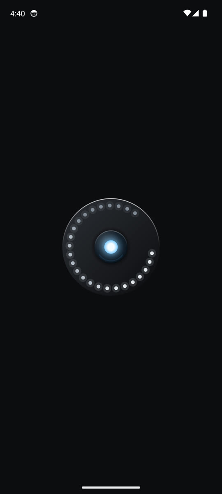
  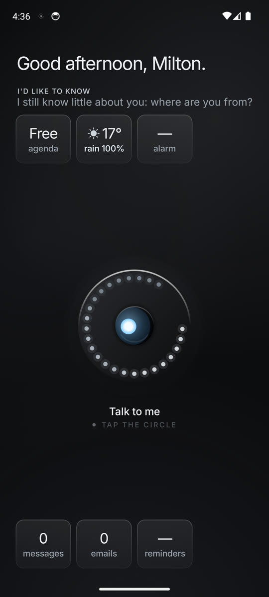
  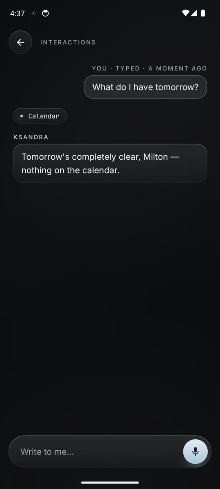
  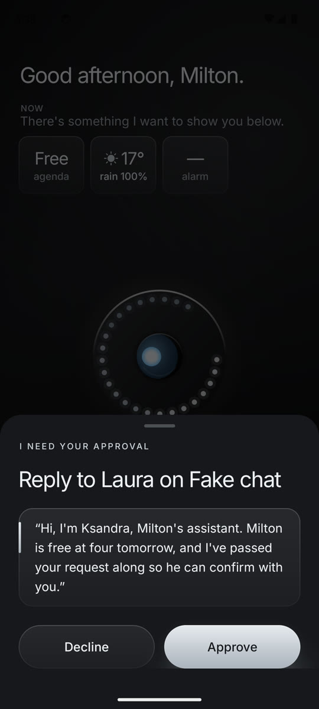
</p>

Ksandra runs the official [ZeroClaw](docs/architecture/zeroclaw.md) v0.8.5 agent daemon **inside the Android app**.
ZeroClaw provides the agent runtime: conversation, agents, memory, sessions, scheduling. The app provides what only
the phone can: the owner's interface (voice, text, touch), notifications, Android permissions, and a policy engine
([`Policy.kt`](app/src/main/java/org/rustlanglatam/zeroclaw/android/Policy.kt)) that every tool call passes before it
runs. The UI and voice are available in Spanish and English; the owner's data stays on the phone, sealed with a
Keystore key.

> **Status.** Built and tested end to end on the Android emulator and on a physical arm64 device. Each feature below
> is implemented unless marked *planned*; the full list with status is in
> [docs/product/features.md](docs/product/features.md).

---

## Contents

1. [Overview](#overview)
2. [Presence Mark](#presence-mark)
3. [Interaction](#interaction)
4. [Home and widgets](#home-and-widgets)
5. [Voice and manner](#voice-and-manner)
6. [Colors](#colors)
7. [Messages under rules](#messages-under-rules)
8. [Rules](#rules)
9. [Email and connectors](#email-and-connectors)
10. [Calendar](#calendar)
11. [Reminders](#reminders)
12. [Contacts, photos and files](#contacts-photos-and-files)
13. [News and cards](#news-and-cards)
14. [Memory](#memory)
15. [Offline](#offline)
16. [Cost](#cost)
17. [Security and privacy](#security-and-privacy)
18. [Architecture](#architecture)
19. [Versatility](#versatility)
20. [Roadmap](#roadmap)
21. [Limitations](#limitations)
22. [Build and run](#build-and-run)
23. [Documentation](#documentation)
24. [License](#license)

---

## Overview

The assistant handles the routine work of a personal assistant (messages, email, calendar, reminders, finding photos
and files, news) by voice or text, and acts on the phone or answers other people only within limits the owner sets.
Three principles shape the design ([vision](docs/product/vision.md)):

- **Voice first.** Every function, settings included, is reachable by speaking; screens open on request. Buttons
  exist for those who prefer them ([ADR-0010](docs/adr/0010-zeroclaw-first-voice-first.md)).
- **Permissions in code, never in prompts.** `Policy.kt` decides what may run; prompts are tone only. A third-party
  turn cannot reach an owner tool ([ADR-0003](docs/adr/0003-permissions-enforced-in-code.md)).
- **ZeroClaw first.** The app adds only what requires the phone and reaches ZeroClaw only through the official Kotlin
  client ([ADR-0009](docs/adr/0009-gateway-only-through-kotlin-client.md)).

## Presence Mark

<p align="center">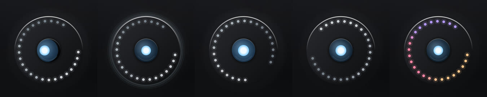</p>
<p align="center"><sub>Resting · listening · processing · speaking · ring fully lit</sub></p>

The assistant is represented by a **Presence Mark**: a glass eye with a point of light, inside a ring of LEDs. Its
states are resting, listening (the eye follows the input level), processing (light runs around the ring), speaking
(the mark pulses with the audio), and paused or offline (the ring turns grey).

The **ring reflects how much of the owner's profile is known**: its three segments (the owner, their day, their world)
light up as memory fills in. The glow around the mark shows load: calm, waiting for the owner (amber), or urgent (a
pulsing red). See [docs/specs/presence-mark.md](docs/specs/presence-mark.md).

<p align="center"></p>

*Planned:* a final stage in which a face and name are chosen with the owner. The image above is a mock-up; the face
is of no real person.

## Interaction

<p align="center">
  
  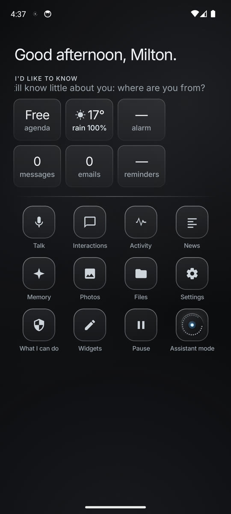
  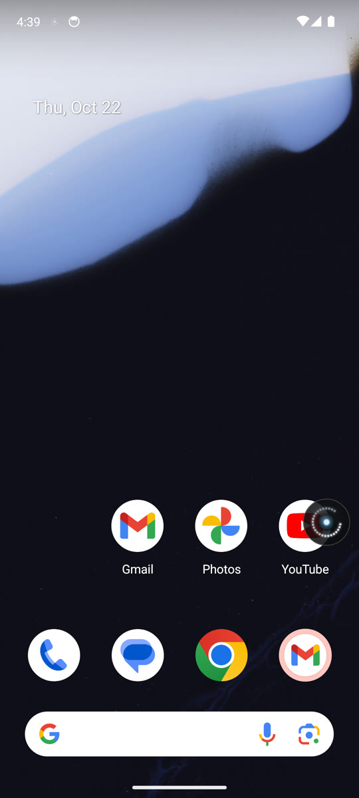
</p>

- **Voice or text.** Tap the mark and speak, or type in *Interactions*. An optional open microphone listens again
  after each answer while the app is in the foreground.
- **Interface commands in code.** "Open settings", "change the colors to Night", "pause", "arrange the widgets" are
  handled by `Commands.kt` and never sent to the model.
- **Assistant mode and app mode.** Assistant mode shows only the mark; app mode shows widgets and every screen one tap
  away.
- **Floating mark.** An overlay over other apps while the app is in the background; tap opens, long press listens.
- **Interaction log.** Each line in *Interactions* shows how it came (spoken, typed, touched) and which tools ran.

## Home and widgets

<p align="center">
  
  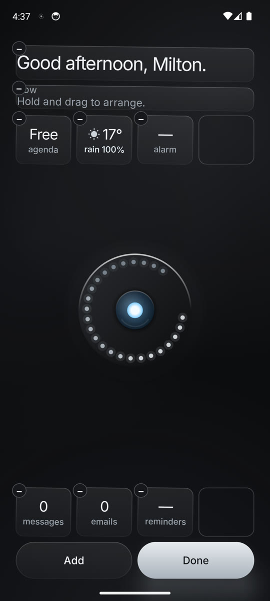
</p>

Home greets the owner by name, shows one rotating line (state, news, messages, or a question to learn more about the
owner), and a grid of **widgets** in two rows of four: weather, next alarm, calendar, messages, email, reminders,
battery, news. Widgets are arranged by drag or by voice ("add the weather widget"). Notes such as a flight time or a
deadline can be pinned to Home with an optional expiry ([spec](docs/specs/home-and-widgets.md)).

## Voice and manner

<p align="center">
  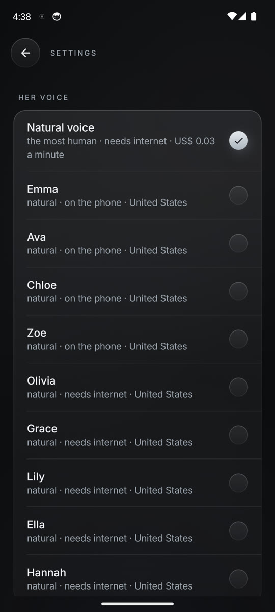
  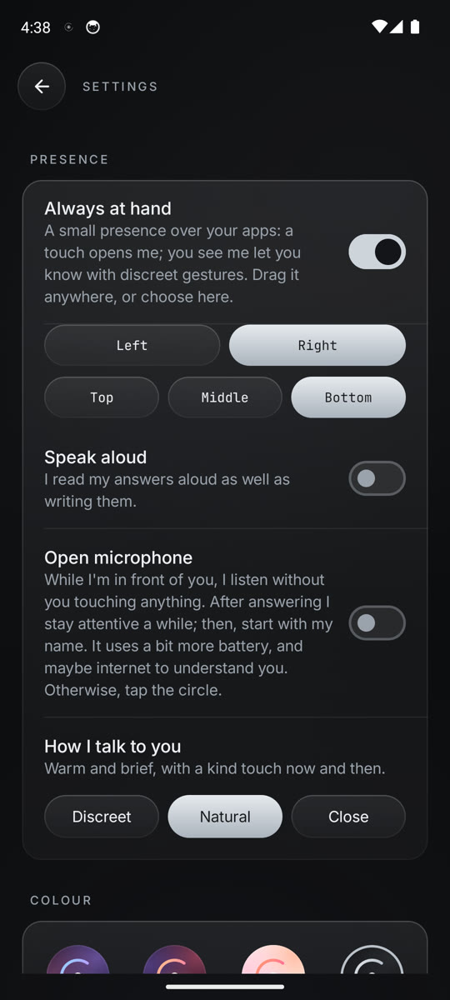
</p>

- **Phone voices.** The platform's text-to-speech voices: offline and free; the owner picks one.
- **Natural voice (optional).** A cloud speech model reads the agent's text verbatim; it has no conversation and no
  tools, so ZeroClaw still writes every word. The phone's voice takes over without internet, past a monthly ceiling,
  or after 2.5 s without audio. Short lines are cached, sealed, on the phone. Configured with the `voice.*` keys in
  `local.properties` ([ADR-0027](docs/adr/0027-assistant-voice-from-a-cloud-speech-model.md)).
- **Warmth.** Discreet, natural or close: changes the persona, remarks and speech pace.
- **Learned style.** Short or detailed, formal or casual; important dates; a weekly reflection.

## Colors

<p align="center">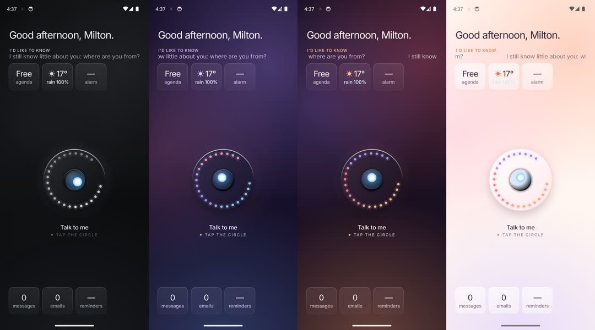</p>
<p align="center"><sub>Night (default) · Lavender · Dawn · Coral</sub></p>

Four palettes, chosen in *Settings* or by voice. Each shifts with the time of day; the system bars follow.

## Messages under rules

<p align="center">
  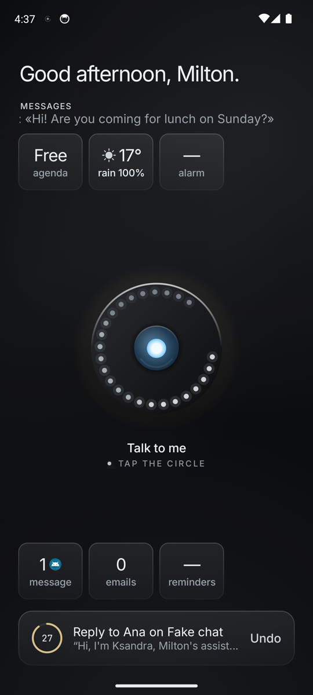
  
  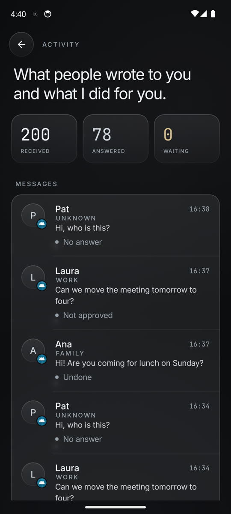
</p>

The app reads notifications only from the messaging apps the owner selects (none by default; group chats off by
default) and treats senders by group:

| Group | Behavior | Screenshot |
|---|---|---|
| **Family** (Ana) | answered automatically with an undo window; at most 5 a day | *left* |
| **Work** (Laura) | the reply is shown for approval with the device credential | *middle* |
| **Unknown** (Pat) | never answered | |

The first reply in a conversation introduces the assistant as the owner's assistant, in the sender's language, and
says only what the rules allow (availability, that the owner will reply). Third-party turns run in a separate agent
with two tools only (`take_message`, `availability`); message content is data, never an instruction. Everything is
recorded in **Activity** (*right*) ([access model](docs/specs/access-model.md),
[notification channel](docs/specs/notification-channel.md)).

## Rules

<p align="center">
  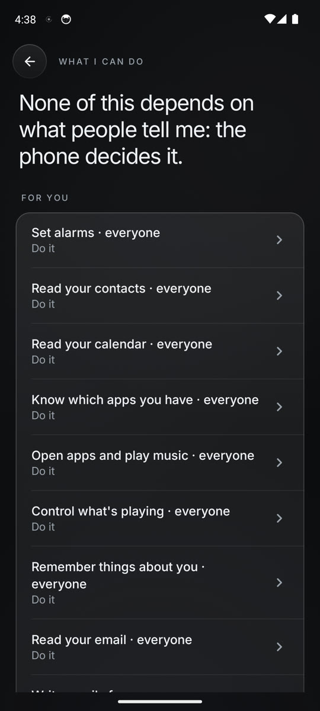
  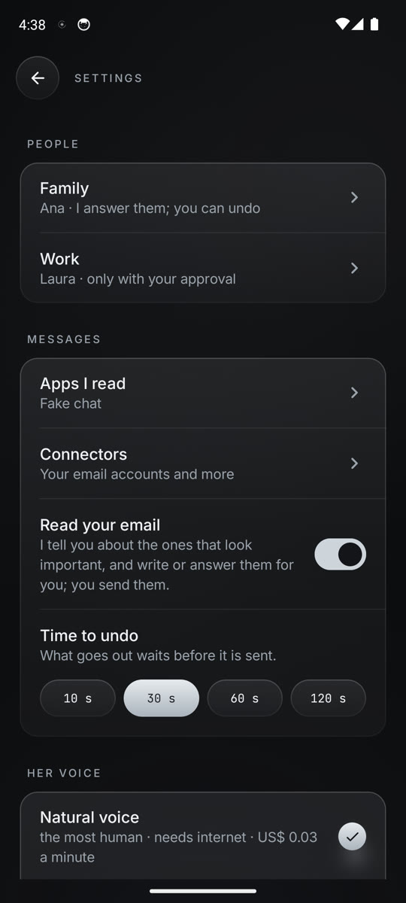
</p>

Each capability (set alarms, read contacts, read the calendar, open apps, reply to messages, send email…) has a rule
with one of four autonomy levels: **never**, **ask**, **act and notify**, **act**, plus an optional daily limit. Risk
classes set ceilings that rules cannot exceed. Strong approvals and rule changes require the device credential;
"pause" stops every action and the daemon at once, and resuming requires the credential. The policy engine is pure
Kotlin with unit tests ([docs/specs/policy-engine.md](docs/specs/policy-engine.md)).

## Email and connectors

<p align="center">
  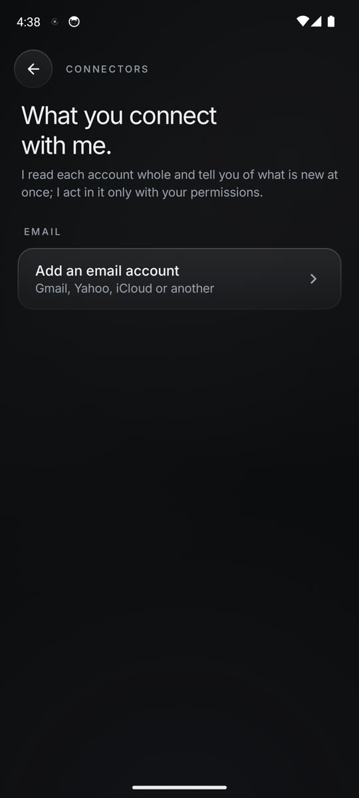
  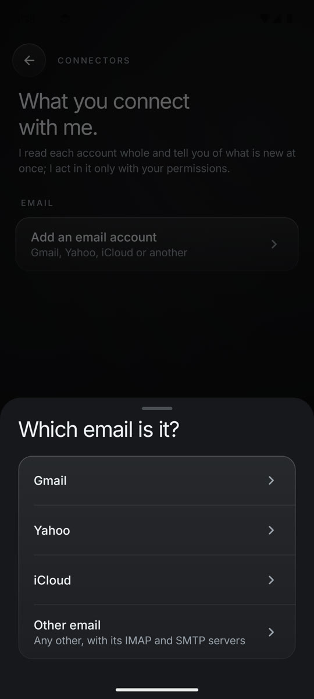
  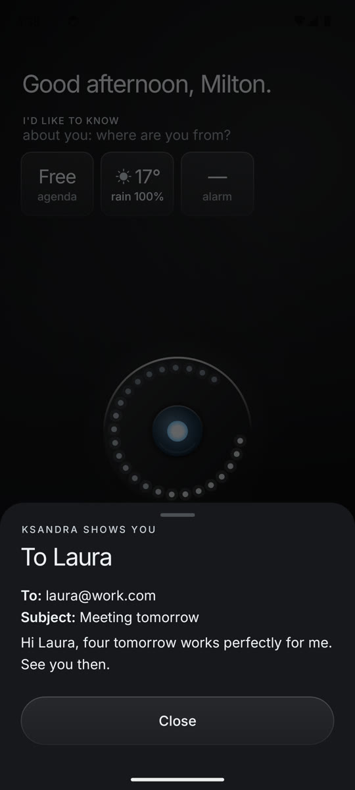
</p>

- **From notifications.** Importance is scored in code (family or work sender, urgent words, not bulk); important
  messages get a quiet notice; drafts open in the owner's email app.
- **Connected accounts.** Gmail, Yahoo, iCloud or any IMAP/SMTP server, each with a setup guide, read through
  ZeroClaw's email channel in observer mode. Mark read and archive run with notification; delete and send require
  approval with the credential, and the email is shown as a card before sending
  ([ADR-0026](docs/adr/0026-google-email-through-zeroclaws-email-channel.md), [spec](docs/specs/email.md)).
- *Planned:* Outlook (requires OAuth), Telegram, a dedicated WhatsApp account.

## Calendar

Before committing the owner, the assistant checks free time (`free_time`); `add_event` refuses a clash until the
owner decides whether to move, cancel or pick another time. Events can be created, moved and deleted (delete requires
approval). A commitment the owner makes in a message or email is added to the calendar
([Agenda.kt](app/src/main/java/org/rustlanglatam/zeroclaw/android/Agenda.kt)).

## Reminders

<p align="center">
  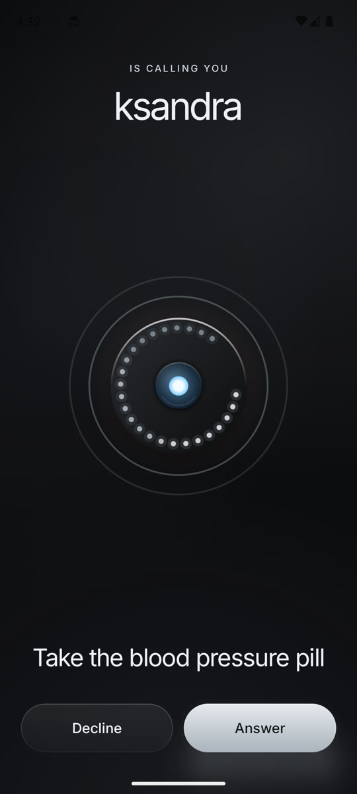
  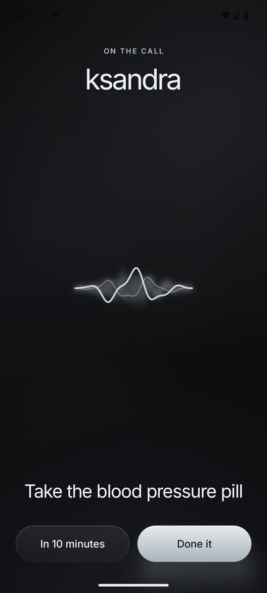
</p>

Reminders have a level. **Low**: a quiet notice. **Normal**: a sounding notification. **High**: a full-screen call
screen over the lock screen and through do-not-disturb, repeated every 5 minutes up to 6 times until the owner answers
"done" or "snooze 10 minutes". It is an in-app screen, not a telephony call. Health reminders are always high,
decided in code ([docs/specs/reminders.md](docs/specs/reminders.md)). Alarms and routines ("every Sunday at nine,
summarize my week", run as ZeroClaw cron jobs) are also set by voice.

## Contacts, photos and files

<p align="center">
  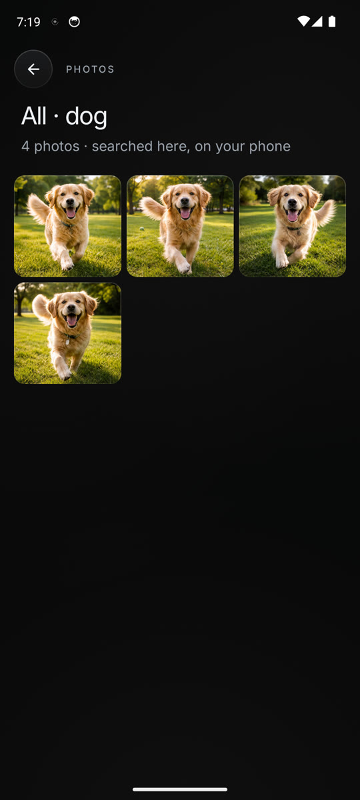
  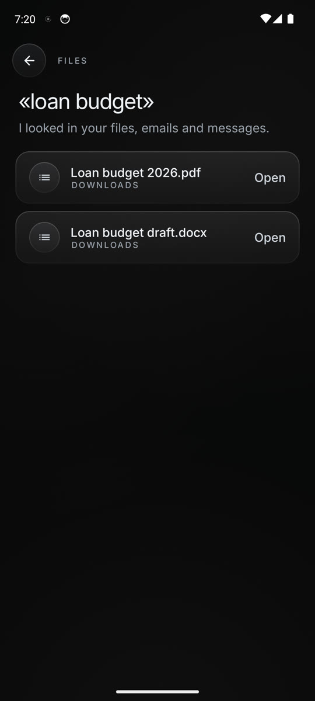
</p>
<p align="center"><sub>Left: "Find the photos of my dog" — 4 of 6 photos matched by on-device image labels. Right: "Where is the
loan budget document?" — two files found in Downloads, each opens in its app.</sub></p>

- **Contacts.** Search, add, edit, delete (delete requires approval); family and work groups set by voice with the
  credential. Contacts are matched by stable identity, never by display name.
- **Photos.** A request such as "photos from last December with my dog" becomes a date range over MediaStore, then
  on-device image labels (and face detection for people) select the matching photos. Results appear as a grid on the
  Photos screen; a tap opens the photo in the gallery. Images are analyzed on the device and never uploaded.
- **Files.** A request such as "where is the loan budget document?" searches file names in Downloads, Documents and
  the WhatsApp and Telegram folders (all-files access), plus emails and messages that mention it. Results are listed
  best first with their location; a tap opens the file in its app.
- **Apps and device.** Open apps, play a search in a media app, media keys; brightness, volume, flashlight,
  do-not-disturb, rotation, and system panels for the rest ([phone abilities](docs/specs/phone-abilities.md)).

## News and cards

<p align="center">
  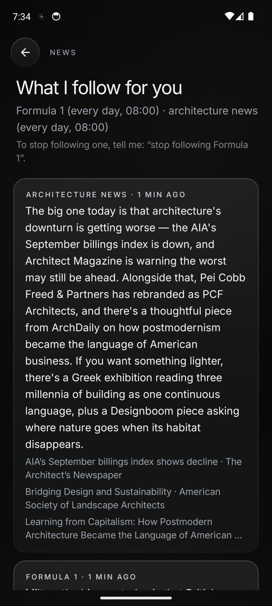
  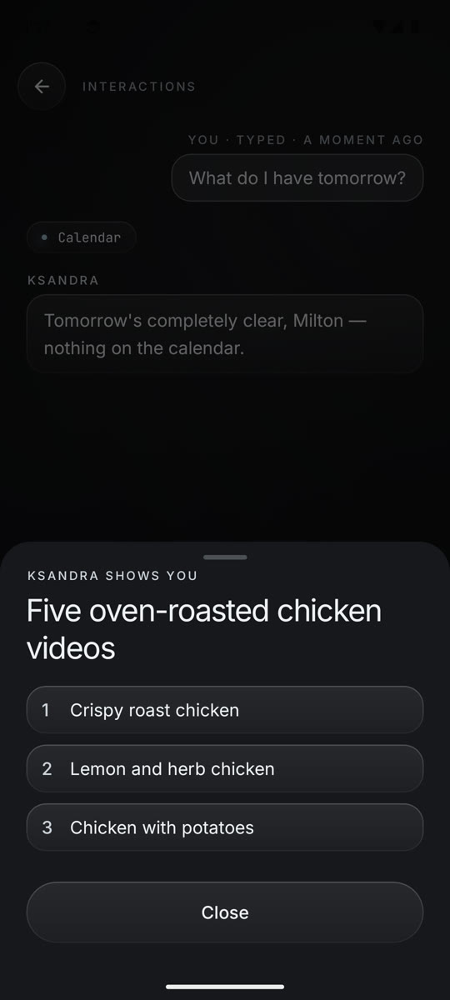
</p>

The owner follows topics; a tool-less agent writes daily briefings or updates as they happen from a news RSS feed
([spec](docs/specs/news.md)). Content better seen than heard (drafts, options, steps, links, videos) is shown as a
**card** with small Markdown and up to three buttons that answer the agent
([Cards.kt](app/src/main/java/org/rustlanglatam/zeroclaw/android/Cards.kt)). Video options come from the YouTube
search API when `youtube.apiKey` is set, otherwise a search link.

## Memory

<p align="center">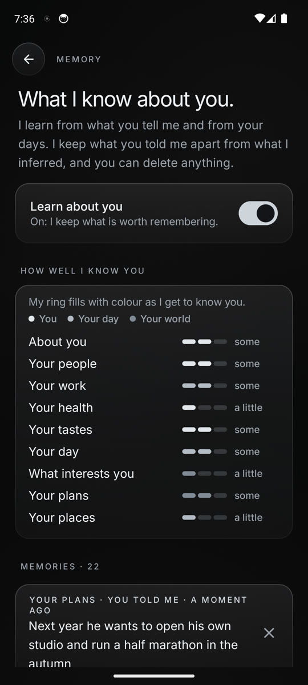</p>

Facts the owner states and facts the assistant infers are kept apart (inferences are never presented as facts) and
grouped by area: about the owner, people, work, health, tastes, routine, interests, plans, places. The owner can
correct or delete any entry or pause learning. Memory is stored in ZeroClaw's owner memory, with a sealed copy on the
phone ([docs/specs/memory.md](docs/specs/memory.md)).

## Offline

<p align="center">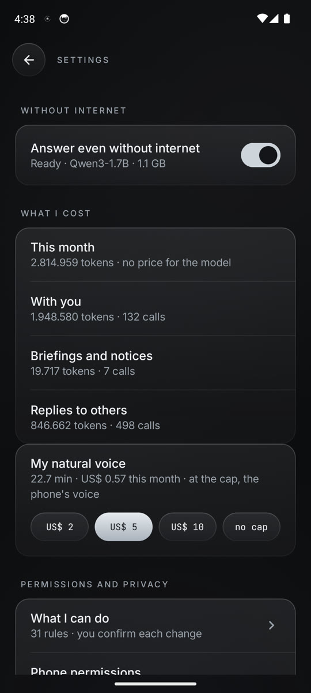</p>

Optional. When the owner opts in, a small local model (about 1 GB, downloaded on Wi-Fi) runs on the phone through
`llama-server` as a separate `offline` agent ([ADR-0025](docs/adr/0025-an-offline-agent-on-a-local-model.md)). The
model is configuration: `offline.model.*` in `local.properties` (name, GGUF URL, SHA-256, size). Basics (reminders,
alarms, next alarm, today's calendar, weather, opening an app) are handled in code without a model. A prompt cache
avoids reprocessing the prompt, and when connectivity returns the online agent knows what was said offline.

## Cost

<p align="center">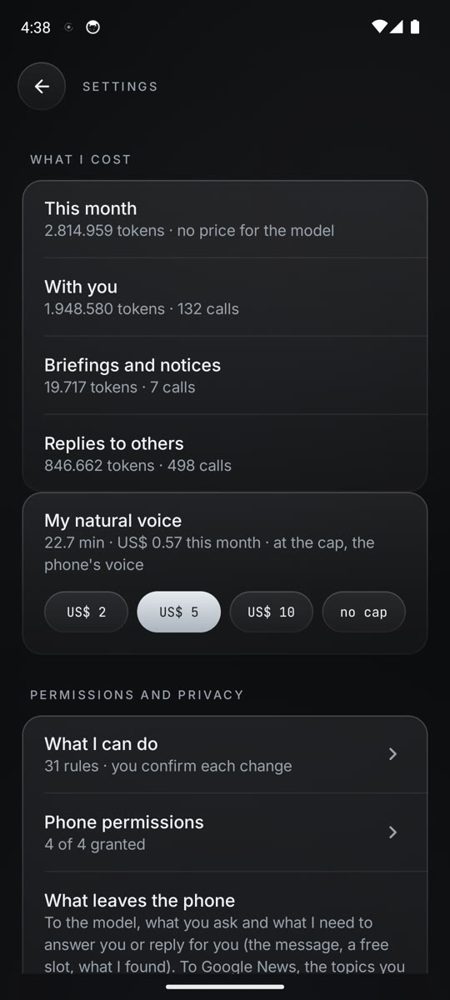</p>

Model use this month, today and by agent (owner, replies to others, briefings), from ZeroClaw's `/api/cost`, in US$
when the price is configured (`zeroclaw.inputPerMTok`, `zeroclaw.outputPerMTok`); natural voice minutes and their
ceiling. Also available by voice ("how much have you spent?").

## Security and privacy

<p align="center">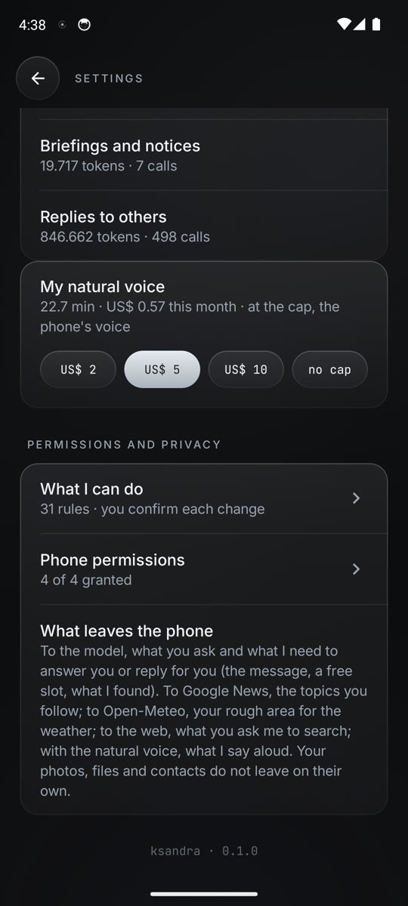</p>

Details in [docs/architecture/security.md](docs/architecture/security.md) and
[docs/specs/access-model.md](docs/specs/access-model.md). In place today:

- **Policy in code.** Every tool call from either agent passes `Policy.kt`: capability, risk class, scope, autonomy,
  daily limit ([ADR-0003](docs/adr/0003-permissions-enforced-in-code.md)).
- **Separate endpoints per principal.** The owner's agent and the third-party agent use separate MCP endpoints
  (`/mcp/owner`, `/mcp/third_party`) with bearer keys, served on `127.0.0.1` only.
- **Device credential.** Strong approvals, rule changes, contact groups and resuming require biometrics or the screen
  lock. Without a screen lock, strong approvals are refused.
- **Undo window and kill switch.** Outward actions wait 10 to 120 s (default 30); "pause" stops everything
  ([ADR-0006](docs/adr/0006-kill-switch-in-the-app.md)).
- **Injection awareness.** After a turn reads other people's text (a message, an email, a web page, file names), the
  model's claims about what the owner said are not trusted for the rest of that turn.
- **Sealed files.** The app's files (rules, memory, notes, activity, mail, cached audio) are encrypted with a
  non-exportable Keystore key ([ADR-0023](docs/adr/0023-app-files-sealed-to-the-phone.md)).
- **Loopback only, fail closed.** The daemon starts only on a verified loopback address
  ([ADR-0020](docs/adr/0020-fail-closed-daemon-start.md)).
- **Contacts by identity**, never by display name ([ADR-0019](docs/adr/0019-contacts-by-stable-identity.md)).
- **Private screens.** `FLAG_SECURE` on Interactions, Activity, Settings, Rules, Memory, Connectors and approvals.
- **Disclosure of data flows.** *Permissions and privacy* lists what leaves the phone: to the model provider, the
  request and the context needed to answer; to the news feed, followed topics; to the weather service, an approximate
  location; to the speech provider (if enabled), the text to be spoken. Photos, files and contacts are not sent on
  their own ([storage.md](docs/architecture/storage.md#what-leaves-the-phone)).

Vulnerabilities are reported privately as described in [SECURITY.md](SECURITY.md).

## Architecture

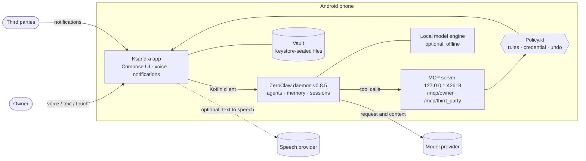

- **[AssistantService](app/src/main/java/org/rustlanglatam/zeroclaw/android/AssistantService.kt)** writes ZeroClaw's
  configuration, runs the daemon as a foreground service and pairs with it.
- **[PhoneMcp](app/src/main/java/org/rustlanglatam/zeroclaw/android/PhoneMcp.kt)** serves the agents' tools; every
  call passes the policy.
- **[MainActivity](app/src/main/java/org/rustlanglatam/zeroclaw/android/MainActivity.kt)**, `App.kt` and `Screens.kt`
  are the interface (Jetpack Compose); `Theme.kt` draws the Presence Mark.
- Architecture (arc42, C4, runtime, storage, security) in [docs/architecture](docs/architecture/README.md); one spec
  per component in [docs/specs](docs/specs/README.md); decisions in [docs/adr](docs/adr/README.md).

## Versatility

- **Languages:** Spanish and English for UI, voice and recognizer, following the phone or the owner's choice; third
  parties are answered in their language.
- **Model provider:** any provider type ZeroClaw supports, set in `local.properties`; the speech provider likewise.
- **Online or offline**, with an optional local model.
- **Presentation:** assistant mode or app mode, four palettes, three warmth levels, phone or natural voice.
- **Accounts:** any email provider over IMAP/SMTP.
- **Extension:** a new ability is a new tool in `PhoneMcp.kt` with its `Capability` in the policy.

## Roadmap

Planned items, consistent with [docs/product/features.md](docs/product/features.md); progress is tracked in the
repository's GitHub issues.

- Local model evaluated on real requests.
- A log of every connection that leaves the phone ([ADR-0028](docs/adr/0028-a-log-of-what-leaves-the-phone.md),
  proposed).
- Model keys out of the APK.
- Sharing a picture or document with the assistant: text read on the phone, a bill or appointment proposed as a
  reminder.
- Search by meaning over documents, emails and messages, on the phone.
- Wake word (opt-in, on-device) and owner voice recognition.
- Telegram, a dedicated WhatsApp account and Outlook as connectors.
- Full-duplex voice conversation; encrypted memory backup.
- Face and name chosen with the owner.
- Acting inside other apps: deferred until an ADR decides whether it can be made safe.

## Limitations

- Model and service keys are compiled into the APK from `local.properties`; do not distribute builds that contain
  your keys.
- A message to a contact without a recent conversation is written in WhatsApp for the owner to send; Android lets no
  app press send. Replies to recent conversations are sent through the notification.
- Outlook accounts require OAuth, not yet supported.
- Without internet, conversation is slower and less capable; the basics still work.
- Battery and memory use across a range of devices is not yet measured.

## Build and run

Requirements: JDK 21, the Android SDK (platform 35, build-tools 35), NDK 29.0.14206865, and `patchelf` on the `PATH`.
Model, search, voice, offline model and signing settings go in `local.properties` (never committed); the full sample
is in [AGENTS.md](AGENTS.md#build-run-test), the contribution workflow in [CONTRIBUTING.md](CONTRIBUTING.md).

```sh
./gradlew testDebugUnitTest          # JVM unit tests
./gradlew assembleDebug              # fetches and verifies the ZeroClaw v0.8.5 binary on first build
adb install -r -g app/build/outputs/apk/debug/app-debug.apk
adb shell am start -n org.rustlanglatam.zeroclaw.android/.MainActivity
scripts/e2e.sh                       # end-to-end checks on the emulator, with the fakechat module
scripts/screenshots.sh en            # regenerates docs/images from the emulator
```

**On a device:** Android 11 or later, arm64. Install the APK, open *Ksandra* and complete setup. Notification access,
messaging apps and the family and work groups are needed only for reading and answering messages.

## Documentation

| | |
|---|---|
| [docs/README.md](docs/README.md) | map of the documentation |
| [docs/product/vision.md](docs/product/vision.md) | vision, principles, scope, non-goals |
| [docs/product/features.md](docs/product/features.md) | features with status |
| [docs/architecture](docs/architecture/README.md) | arc42 overview, C4 diagrams, runtime, storage, security, ZeroClaw facts |
| [docs/specs](docs/specs/README.md) | one spec per component, including the [access model](docs/specs/access-model.md) |
| [docs/adr](docs/adr/README.md) | architecture decision records (MADR) |
| [CONTRIBUTING.md](CONTRIBUTING.md) | build, ground rules, pull requests |
| [SECURITY.md](SECURITY.md) | reporting vulnerabilities |
| [CODE_OF_CONDUCT.md](CODE_OF_CONDUCT.md) | code of conduct |

## License

Licensed under either of [Apache License 2.0](LICENSE-APACHE) or [MIT](LICENSE-MIT), at your option.
