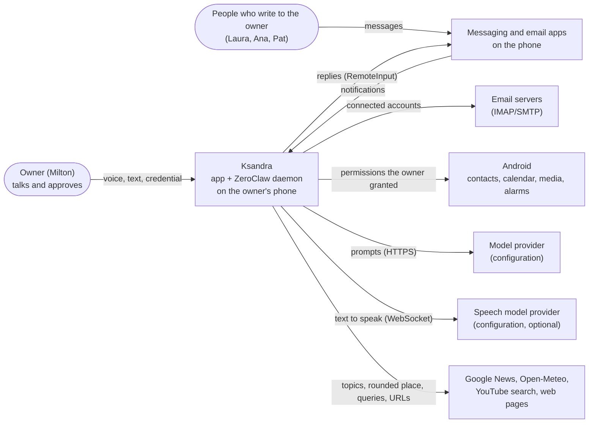
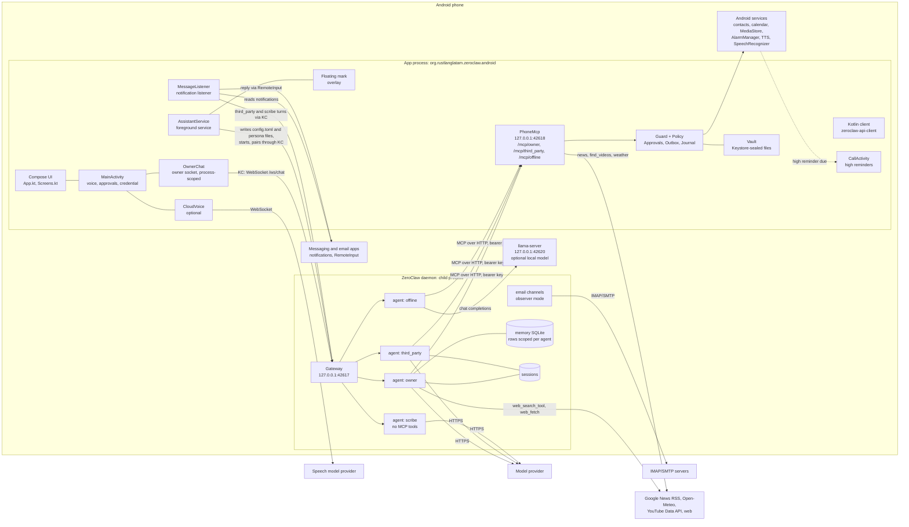

# Architecture overview

The system is two programs on one phone. The **ZeroClaw daemon** (the official v0.8.5 Android
binary, `libzeroclaw.so`) is the agent runtime: it holds the conversations, calls the model provider
and selects the next tool call. The **Android app** starts the daemon, talks to it through the
Kotlin client, and is the only component that can act on the phone: every tool available to the
agents is served by the app and passes the app's policy before it runs.

This folder follows the arc42 sections, with C4 diagrams (context below, containers and components
under [Components](#components)). Component details are in the [specs](../specs/README.md);
decision rationale in the [ADRs](../adr/README.md). Known limitations are stated where they apply.

| arc42 section | Where |
|---|---|
| 1. Introduction and goals | [product/vision.md](../product/vision.md) |
| 2. Constraints | [ZeroClaw facts](zeroclaw.md); Android limits in [product/vision.md](../product/vision.md#android-reach) |
| 3. Context and scope | [System context](#system-context) |
| 4. Solution strategy | [ADR-0001](../adr/0001-run-official-zeroclaw-daemon-in-app.md), [ADR-0002](../adr/0002-phone-tools-over-loopback-mcp-per-principal.md), [ADR-0003](../adr/0003-permissions-enforced-in-code.md), [ADR-0010](../adr/0010-zeroclaw-first-voice-first.md) |
| 5. Building blocks | [Components](#components); one [spec](../specs/README.md) each |
| 6. Runtime view | [how-it-connects.md](how-it-connects.md): start, chat, tools, messages, approvals, reminders, news, catch-up, voice, offline |
| 7. Deployment view | [Threads and processes](#threads-and-processes), [Ports](#ports) |
| 8. Cross-cutting concepts | [security.md](security.md), [storage.md](storage.md), [model-and-code.md](model-and-code.md), [access model](../specs/access-model.md), [Localization](#localization) |
| 9. Architecture decisions | [adr/](../adr/README.md) |
| 10. Quality requirements | [access model › principles](../specs/access-model.md#principles) |
| 11. Risks and technical debt | [security.md › Known gaps](security.md#known-gaps) |
| 12. Glossary | [Glossary](#glossary) |

## System context

## Components

| Component | File | Role |
|---|---|---|
| Compose UI | `App.kt`, `Screens.kt`, `Theme.kt`, `HomeWidgets.kt` | the screens; the Presence Mark renders `Presence` (resting, listening, processing, speaking, paused, offline) |
| `MainActivity` | `MainActivity.kt` | speech in and out, approval prompts, the owner's credential (`confirmOwner`), `FLAG_SECURE` on private screens, settings |
| `OwnerChat` | `OwnerChat.kt` | the owner's `/ws/chat` socket, scoped to the process; restores the session's last lines; routes turns to the `offline` agent without connectivity; `Promises` withholds answers that claim an action no tool performed |
| `AssistantService` | `AssistantService.kt` | foreground service (`specialUse`): writes `config.toml` and the persona files, starts the daemon, waits for `/health`, pairs, serves `PhoneMcp`, posts approval and undo notifications |
| `PhoneMcp` | `PhoneMcp.kt` | minimal MCP server (JSON-RPC over HTTP/1.1) on `127.0.0.1:42618`; one endpoint and one bearer key per principal; every tool call goes through `Guard.gated` |
| `Guard`, `Policy` | `PhoneMcp.kt`, `Policy.kt`, `Approvals.kt` | the policy engine (pure Kotlin, unit-tested), pending approvals, the outbox with its undo window, the activity log; persisted in `policy.json` |
| `MessageListener`, `Turns` | `MessageListener.kt`, `Inbox.kt`, `Mailbox.kt` | reads messaging and email notifications; runs `third_party` turns one at a time; replies through the notification's reply action |
| Email accounts | `EmailAccounts.kt`, `PhoneEmail.kt`, `Connectors.kt` | IMAP/SMTP accounts configured as ZeroClaw email channels in observer mode; the app watches, marks, archives, deletes and sends under the policy |
| Reminders | `Reminders.kt`, `PhoneReminders.kt` | exact alarms; a high reminder opens `CallActivity`, a full-screen call screen (not a telephony call) |
| Routines | `Routines.kt` | owner routines as ZeroClaw cron jobs; results read from `/api/events` |
| News | `News.kt`, `PhoneNews.kt` | followed topics, Google News RSS, briefings written by the `scribe` agent |
| Catch-up | `Absence.kt`, `CatchUp.kt` | heartbeat and network watch; reports what happened during an absence |
| Memory | `Memory.kt`, `PhoneMemory.kt` | the owner's profile, kept in ZeroClaw's memory through the Kotlin client, with a sealed copy on the phone |
| Offline | `Offline.kt` | opt-in local model download, `llama-server` engine with a persistent prompt cache, direct handling of basic requests |
| Voice | `Voice.kt`, `CloudVoice.kt` | platform TTS voices; optional cloud speech model as the voice, platform TTS as fallback |
| Usage | `Usage.kt` | model cost from ZeroClaw's `/api/cost`; cloud voice minutes |
| Localization | `Language.kt`, `Lexicon.kt`, `res/values*/strings.xml`, `assets/lexicon.json` | UI text and input keywords per language; see [Localization](#localization) |
| `Vault` | `Vault.kt` | AES-256-GCM sealing of the app's files under a non-exportable Keystore key |
| Floating mark | `Floating.kt` | overlay over other apps while the app is in the background; tap opens, long press opens listening |
| Kotlin client | `io.github.rustlanglatam:zeroclaw-api-client:0.1.2` | health, pairing, memory, cron, events, cost and the chat WebSocket; the app's only way into the gateway ([ADR-0009](../adr/0009-gateway-only-through-kotlin-client.md)) |
| ZeroClaw daemon | `libzeroclaw.so` (downloaded and checksum-verified at build time) | gateway, four agents (`owner`, `third_party`, `scribe`, `offline`), email channels, memory, sessions, cron, model calls, native web and memory tools for the owner agent |

## Localization

- **UI text** is in Android string resources: `res/values/strings.xml` (English, default) and
  `res/values-es/strings.xml` (Spanish). Code resolves it with `t(R.string.key, args…)` and
  `tn(R.plurals.key, count, args…)` (`Language.kt`) in the assistant's language (`Language.current`:
  the owner's choice, else the device language, else Spanish), which may differ from the device
  locale ([ADR-0029](../adr/0029-ui-text-in-android-string-resources.md)).
- **Input keywords** used to understand spoken or typed input in code (interface commands, reminder
  parsing, health words, email importance words, memory areas, device settings) are regular
  expressions and word lists per key in `assets/lexicon.json`, read through `Lexicon[key]` and
  `Lexicon.words(key)`. Each entry covers Spanish and English.
- **Stored values** (message status `Inbox.Status`, section keys in `Sections`) are English
  constants; stored status values from earlier versions are migrated on load (`Inbox.Status.migrate`).
- Agent prompts and persona files are written in English; the persona tells each agent which
  language to use with the owner (`Language.current`).

## Threads and processes

- The daemon is a child process started with `ProcessBuilder` from the app's native library
  directory, with `HOME` and `TMPDIR` set to the app's private directories and output to
  `cache/zeroclaw.log` (the previous run's log is kept as `zeroclaw.previous.log`). It lives as long
  as `AssistantService` (`START_STICKY`); `onDestroy` destroys it.
- `llama-server` (`libllama-server.so`) is a second child process, started only when offline answers
  are enabled and the model is downloaded.
- `PhoneMcp` accepts on one thread and serves each connection on its own thread.
- The owner's chat socket belongs to `OwnerChat`, not to the activity, so rotation or backgrounding
  does not close it mid-turn.
- Approvals block the MCP thread that asked, for up to 60 s.
- The outbox runs queued sends on a single scheduled thread.
- `CatchUp` writes a heartbeat once a minute on a daemon thread.

## Ports

| Port | Bound by | Path | Caller |
|---|---|---|---|
| `127.0.0.1:42617` | ZeroClaw gateway (`--host 127.0.0.1 --port 42617`) | `/health`, `/pair`, `/pair/code`, `/admin/paircode/new`, `/api/memory`, `/api/cron`, `/api/events`, `/api/cost`, `/ws/chat` | the app, through the Kotlin client |
| `127.0.0.1:42618` | `PhoneMcp` | `/mcp/owner`, `/mcp/third_party`, `/mcp/offline` (POST only, else 405; bearer key required, else 401) | ZeroClaw's MCP client, one server entry per agent |
| `127.0.0.1:42620` | `llama-server` (optional) | chat-completions `/v1`, `/slots` | ZeroClaw (`offline` agent); the app for slot save and restore |

All bind `127.0.0.1` explicitly: on Android the loopback name can resolve to `::1`
([ADR-0005](../adr/0005-bind-loopback-ipv4-explicitly.md)). Loopback is reachable by every app on
the phone; see [security.md](security.md#loopback-exposure).

## Glossary

| Term | Meaning |
|---|---|
| Owner | the phone's owner, the only principal allowed to use owner tools (Milton in examples) |
| Third party | anyone who writes to the owner; their turns run as the `third_party` agent |
| Principal | who caused a turn: owner or third party; fixed by the MCP endpoint |
| Capability | a kind of action with a risk class and a ceiling (`Policy.kt`) |
| Rule | the autonomy for a capability, principal and scope: never, ask, act_notify, act |
| Gated | a tool call decided by the policy (`Guard.gated`) |
| Undo window | the seconds an outward action waits before it is sent |
| Kill switch | Pause: every gated call is refused until the owner resumes with the device credential |
| Presence Mark | the assistant's on-screen indicator: an open ring of LEDs around a pearl |
| Turn | one request to an agent and its answer, with the tool calls in between |
| Catch-up | the summary given after the assistant was unavailable |
| Scribe | the tool-less agent for unattended turns that carry third-party text ([ADR-0018](../adr/0018-tool-less-agent-for-unattended-turns.md)) |
