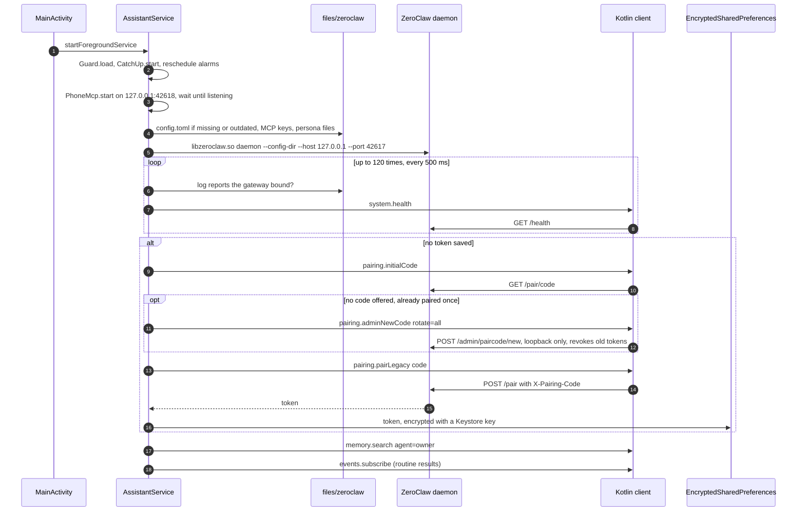
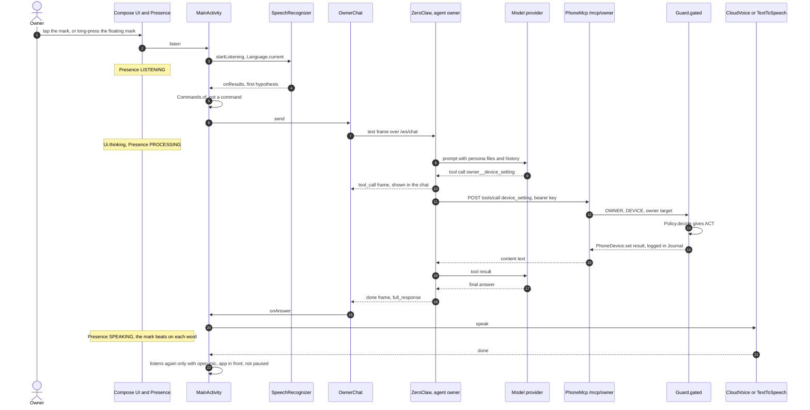
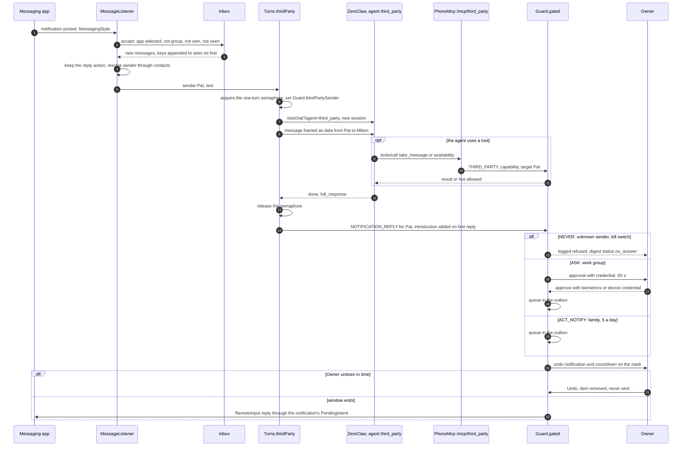
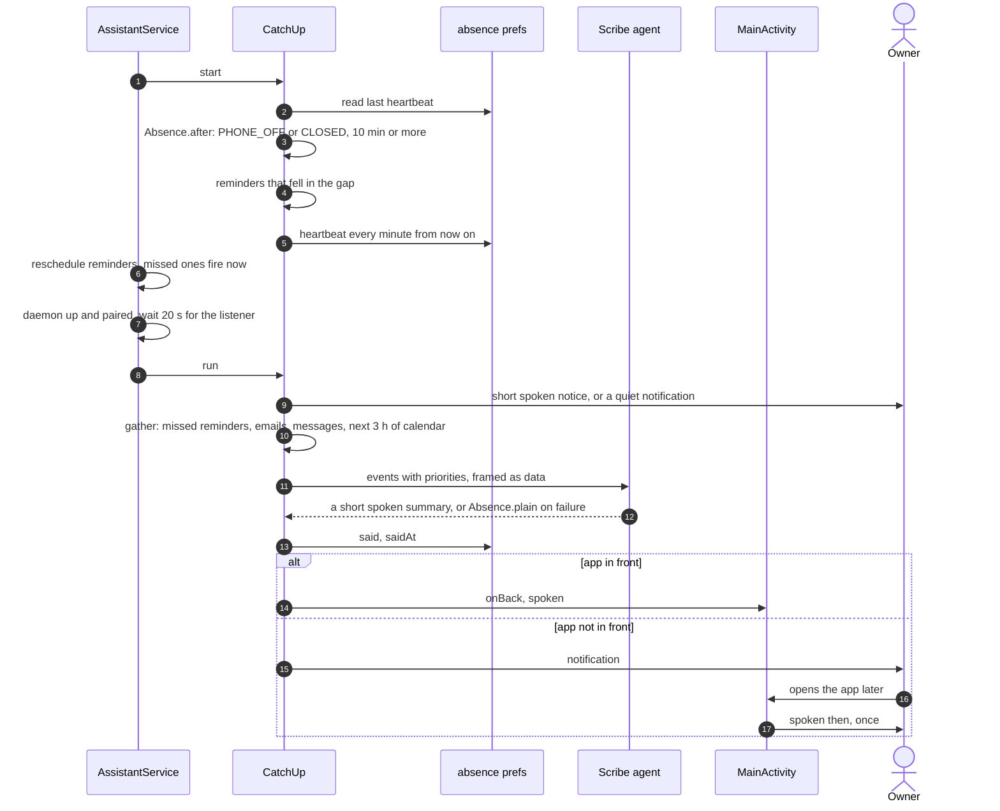
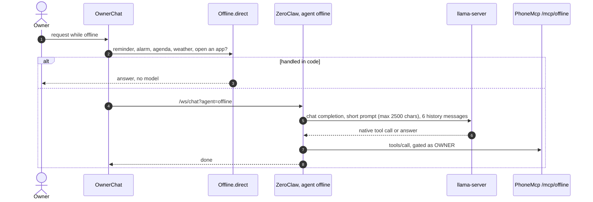

# Runtime view

Every link between the app, the daemon, Android and external services, in the order they come up.

| From | To | Transport | Authentication |
|---|---|---|---|
| `AssistantService` | ZeroClaw daemon | `ProcessBuilder`, files in `files/zeroclaw/` | none (same app user) |
| app (Kotlin client) | gateway `127.0.0.1:42617` | HTTP and WebSocket | bearer token from pairing; `/health`, `/pair/code`, `/pair` and `/admin/paircode/new` without it |
| ZeroClaw agents | `PhoneMcp` `127.0.0.1:42618` | MCP, JSON-RPC over HTTP/1.1 | per-endpoint bearer key, generated per app process ([ADR-0016](../adr/0016-mcp-key-per-endpoint.md)); the path fixes the principal |
| ZeroClaw agents | model provider | HTTPS | API key from `config.toml` |
| `offline` agent | `llama-server` `127.0.0.1:42620` | HTTP, chat completions | none (loopback) |
| owner agent | web | HTTPS (`web_search_tool`, `web_fetch`) | search provider key when configured |
| ZeroClaw email channels | IMAP/SMTP servers | TLS | the account's app password, in `config.toml` |
| `MessageListener` | messaging and email apps | notification listener; `RemoteInput` reply | Android notification access, granted by the owner |
| `PhoneNews` | `news.google.com/rss` | HTTPS | none |
| `PhoneWidgets`, `weather` tool | `api.open-meteo.com` | HTTPS | none |
| `Videos` (`find_videos`) | YouTube Data API | HTTPS | `youtube.apiKey` when configured; else a YouTube search link |
| `CloudVoice` | speech model provider | WebSocket (TLS) | `voice.apiKey` ([ADR-0027](../adr/0027-assistant-voice-from-a-cloud-speech-model.md)) |
| `PhoneReminders`, `PhoneNews` | `AlarmManager` → `ReminderReceiver`, `NewsReceiver` | broadcasts (not exported) | `PendingIntent.FLAG_IMMUTABLE` |
| notifications | `ApprovalReceiver`, `MainActivity` | broadcasts and activity intents | immutable `PendingIntent`s; strong approvals go through `BiometricPrompt` |

## Start and pairing

The service starts from `MainActivity` or from `MessageListener.onListenerConnected`. On the first
start in a process it:

1. loads `policy.json`, the email accounts and the offline settings (`Guard.load`,
   `EmailAccounts.load`, `Offline.load`);
2. reads the heartbeat to detect an absence (`CatchUp.start`), then reschedules every reminder and
   news alarm (alarms do not survive a reboot);
3. wires `Guard` to its notifications (approval, `ACT_NOTIFY` done, undo), starts watching connected
   email accounts (`PhoneEmail.watch`) and starts `PhoneMcp`;
4. on a thread, waits up to 20 s for `PhoneMcp` to listen; if the port cannot be opened, the daemon
   is not started ([ADR-0020](../adr/0020-fail-closed-daemon-start.md));
5. under `supervise` (restart with backoff from 2 s to 60 s): rewrites `config.toml` when it is
   missing, its version mark (`# ksandra-config 20`, kept in prefs) differs, or it lacks an agent,
   a tool name or the current email channels, dropping the saved token when it does; injects this
   process's MCP keys (`Loopback.withKeys`); writes the persona files; kills any daemon left by an
   earlier process (`stopStale`); starts the daemon; waits up to 60 s until the process is alive, its
   log reports binding the gateway port, and `/health` answers; pairs if there is no token; starts
   listening for routine results; syncs memory;
6. after the first successful start, if an absence was detected, runs the catch-up 20 s later.



A chat refused with 401 makes the app pair again (`AssistantService.pair(refused = token)`); the
call is `@Synchronized` and skips the work if another socket already re-paired.

## The owner's chat

`OwnerChat` holds one socket to `/ws/chat?agent=owner&session_id=<saved>`, opened through
`Turns.open`, scoped to the process rather than to `MainActivity`, so rotation or backgrounding does
not close it mid-turn. The session id from `session_start` is stored in the encrypted prefs, so the
conversation persists across restarts (ZeroClaw keeps its history); on a resumed session with an
empty screen, the last 30 lines are restored from ZeroClaw's session store. On failure the socket
reconnects after one second.

| Frame | App behavior |
|---|---|
| `session_start` | stores the session id; `Ui.ready = true` |
| `tool_call` | adds a tool line (`Labels.tool`); a tool that returns other people's text sets `Guard.heardOthers` |
| `done` | if the answer claims an action and no tool ran in the turn (`Promises`), withholds it and sends the agent a correction note; otherwise adds the answer and passes it to `onAnswer` to be spoken |
| `error` | shows a failure line (`R.string.ownerchat_something_failed`) |

Owner input first goes through `Commands.of`: an interface command (screens, menu, pause, resume,
app or assistant mode, widgets) is handled in the app and never sent. Anything else clears
`Guard.undecided` and is sent as a text frame. Without connectivity, turns go to the `offline` agent
instead (see [Offline answers](#offline-answers)).

### A spoken turn



Presence is derived in `presence()`: paused (kill switch) first, then listening, speaking,
processing (`Ui.thinking`), offline (`!Ui.ready`), resting.

## ZeroClaw calls the app's tools (MCP)

`config.toml` declares three MCP servers, each in its own bundle given to one agent only:
`owner` → `http://127.0.0.1:42618/mcp/owner`, `third_party` → `.../mcp/third_party`, and
`offline` → `.../mcp/offline` (owner principal, restricted to `Offline.TOOLS`). Each entry carries
`Authorization: Bearer <key>`; keys are random per app process and compared in constant time. ZeroClaw
prefixes tool names with the server (`owner__remind`); `allowed_tools` and `auto_approve` list
exactly those names.

`PhoneMcp` is a hand-rolled HTTP/1.1 reader (one request per connection, `Content-Length` bodies up
to `Loopback.MAX_BODY`, no chunking; the body is read only after authentication). It answers:

| Request | Answer |
|---|---|
| not `POST`, or unknown path | `405` |
| missing or wrong bearer key | `401`, logged |
| a `Content-Length` that is not a number or is over `Loopback.MAX_BODY` (1 MiB) | `413` |
| `initialize` | protocol version echoed, `tools` capability, server `phone` |
| `tools/list` | the endpoint's tools only |
| `tools/call` | a single `text` content item |
| a notification (no `id`) | `202`, empty body |
| anything else | empty result |

The principal is fixed by the path, never by the request body or the model. A tool name outside the
endpoint's set is refused and logged. Every tool that acts goes through
`Guard.gated(principal, capability, target, act) { action }`; see [security.md](security.md#guardgated).

Owner tools (`PhoneMcp.TOOLS`), by area:

| Area | Tools |
|---|---|
| Alarms, reminders, routines | `create_alarm`, `next_alarm`, `cancel_alarm`, `remind`, `list_reminders`, `move_reminder`, `cancel_reminder`, `add_routine`, `list_routines`, `remove_routine` |
| Calendar | `list_events`, `free_time`, `add_event`, `move_event`, `delete_event` |
| Contacts and messages | `search_contacts`, `add_contact`, `edit_contact`, `delete_contact`, `set_contact_group`, `list_messages`, `send_message`, `act_on` |
| Email | `list_emails`, `read_email`, `draft_email`, `connect_email`, `email_mark_read`, `email_archive`, `email_delete`, `send_email` |
| Apps and media | `list_apps`, `open_app`, `play_media`, `media_control`, `find_videos` |
| Photos and files | `find_photos`, `find_files` |
| News and weather | `news`, `follow_topic`, `unfollow_topic`, `list_topics`, `weather` |
| Memory | `remember`, `forget`, `recall`, `how_well_i_know_you`, `set_address` |
| Device | `device_setting`, `device_status` |
| Interface and settings | `show`, `show_on_home`, `remove_from_home`, `open_section`, `set_mode`, `set_preference`, `my_settings`, `list_rules`, `set_rule`, `usage` |

Third-party tools: `take_message`, `availability`. Offline tools: `remind`, `list_reminders`,
`create_alarm`, `next_alarm`, `list_events`, `open_app`.

The owner agent also has ZeroClaw's native `web_search_tool`, `web_fetch`, `calculator`,
`memory_store`, `memory_recall` and `memory_forget`, plus `email_search` and `email_read` when an
email account is connected. These run inside ZeroClaw and do not pass through the app's policy
(see [security.md](security.md#zeroclaws-approvals-and-the-apps-policy)).

## The notification channel

`MessageListener` receives every posted notification:

- **Email** (category `email` or a known email app, not a group summary): stored in `Mailbox`
  (last 100), scored for importance, and announced if important (`MailNotice`). No agent turn runs.
- **Messages**: `MessagingStyle` messages from the apps the owner selected (`Inbox.apps`), excluding
  group chats unless allowed, the owner's own messages, messages already seen (`seen.txt`) and
  messages older than the first time the assistant read messages. The sender is resolved through
  the contacts, never from the displayed name ([ADR-0019](../adr/0019-contacts-by-stable-identity.md)).
  Each new message is recorded in the digest (`Inbox.Status.RECEIVED`) and starts a `third_party`
  turn; with the kill switch on, no turn runs and the entry is marked `PAUSED`.

`onListenerConnected` replays the notifications still shown, so messages received while the app was
not running are handled; `seen.txt` prevents double answers.



Details:

- One turn at a time (`Semaphore(1)`), because an MCP call does not identify its turn
  ([ADR-0007](../adr/0007-third-party-turns-one-at-a-time.md)); `Guard.thirdPartySender` names the
  sender for the tools. A turn that does not finish in 180 s is cancelled. The semaphore is released
  before the reply is gated, so an approval wait does not block the next turn.
- Each third-party turn opens a new session (no `session_id`).
- The reply is gated **after** the turn, in the app, with the target taken from the notification,
  not from the model.
- The first reply in a conversation is prefixed with an introduction (`R.string.inbox_intro`, in
  the language the sender wrote in) unless the answer already contains one (`Inbox.withIntro`);
  introduced conversations are kept in `introduced.txt`.
- With the app in the foreground, the source app's notification is cancelled and the app's chime
  plays instead; the reply action is kept.
- No reply action, or the notification is gone: the entry is marked `COULD_NOT_ANSWER` and the
  owner is told.

## Approvals and the undo window

| Event | Where the owner sees it | How the answer returns |
|---|---|---|
| `ASK`, app in front | `Ui.pending` prompt in the app, also spoken | `MainActivity.answer`; a strong approval runs `confirmOwner` first |
| `ASK`, app not in front | high-importance notification with Approve / Decline | normal: broadcast to `ApprovalReceiver`; strong: Approve opens `MainActivity` with `approve=<id>`, which asks for the credential |
| `ACT_NOTIFY` (not undoable) | "done" notification | — |
| undoable action queued | countdown on Home and on the floating mark (a closing ring); a notification with Undo only when neither is visible | `ApprovalReceiver` with `undo=<id>` → `Guard.undo` |

`Approvals.request` blocks the calling MCP thread on a `CompletableFuture` for 60 s; a timeout or
any exception is a no. `Outbox.queue` schedules the send after `undoSeconds` (10, 30, 60 or 120;
default 30); undo and send race on one `remove`, so an undone item is never sent. When the window
ends, the kill switch is checked again: a queued action is held back (`HELD_BACK`) if the assistant
was paused meanwhile.

## Reminders and the call screen

`remind` stores the reminder in `reminders.json` and sets an alarm: `setAlarmClock` for a high
reminder (or when exact alarms are not allowed), `setExactAndAllowWhileIdle` otherwise. The alarm
fires `ReminderReceiver` → `PhoneReminders.due`.

| Level | Behavior |
|---|---|
| low | quiet notification and a notice beside the floating mark |
| normal | sounding notification (the app's chime and voice when the app is open) |
| high | full-screen notification in category `call` on a channel that bypasses do-not-disturb; `CallActivity` started directly when the app may draw overlays; another attempt 5 minutes later, at most 6 attempts |

```mermaid
sequenceDiagram
  autonumber
  participant AO as Owner agent
  participant MCP as PhoneMcp remind
  participant R as PhoneReminders
  participant AM as AlarmManager
  participant RR as ReminderReceiver
  participant CA as CallActivity
  actor O as Owner
  AO->>MCP: remind text "take the pill", level normal
  MCP->>MCP: Reminders.level raises it to HIGH (health word)
  MCP->>R: add, reminders.json
  R->>AM: setAlarmClock at the time
  AM->>RR: alarm fires
  RR->>R: due
  R->>O: full-screen call notification, DND bypass
  R->>CA: start, if overlays are allowed
  R->>AM: next attempt in 5 minutes
  CA->>O: alarm ringtone and vibration, up to 45 s
  alt answered
    CA->>O: speaks the reminder, up to five rounds
    alt Done
      O->>CA: done
      CA->>R: cancel; daily reminders move to the next day
    else Snooze
      O->>CA: snooze
      CA->>R: again in 10 minutes
    end
  else not answered in 45 s
    CA->>O: missed-call notification
    AM->>RR: next attempt, up to 6
  end
```

After a reboot, `rescheduleAll` sets future reminders again and fires past ones at once.

## Routines

`add_routine` builds and validates a cron expression in code and registers a ZeroClaw cron job
(`job_type: "agent"`, name prefixed `ksandra: `) that runs an owner turn. `Routines.listen`
subscribes to `/api/events` for each daemon run and relays `cron_result` events to the owner.
Tool calls inside a routine go through the policy like any owner turn.

## News

`follow_topic` stores the topic in `topics.json`, marks current headlines as seen, and sets an
inexact alarm (`setWindow`, 10-minute window) for its daily time or every N hours. `NewsReceiver` →
`PhoneNews.check` fetches `news.google.com/rss/search?q=<topic> when:2d`, keeps unseen headlines, and
if any, runs a `scribe` turn (new session) asking for a 2 to 4 sentence briefing. The answer, or a
plain list of headlines if the turn fails, is stored in `briefings.json` (last 30), shown in News,
spoken with the app open, and otherwise posted as a notification. The `news` tool fetches the same
feed on demand.

## Back after an absence

`CatchUp.start` compares the last heartbeat (`absence` prefs, written every minute) with the boot
time: an absence of 10 minutes or more is `PHONE_OFF` (booted after the last heartbeat) or `CLOSED`.
A network callback records when the phone went offline; back online after 5 minutes or more is
`OFFLINE`.



Priorities, lowest first: missed high reminder 0, important email 1, missed reminder 2, unanswered
message 3, calendar in the next 3 hours 4, the rest 5. With the kill switch on, the catch-up does
nothing.

## The floating mark

When setup is complete, the floating mark setting is on, the app is not in front and the app may
draw overlays, `Floating` shows a 56 dp `TYPE_APPLICATION_OVERLAY` view. Tap opens `MainActivity`;
long press opens it with `listen=true`. Once a second it checks for new digest entries and pending
approvals and shows three pulses and a short label. Reminders, briefings and important emails also
show a label. The undo countdown is drawn as a closing ring; with the kill switch on, the mark is
grey.

## Voice

- **Speech in**: `SpeechRecognizer` inside the app (no dialog) when `RECORD_AUDIO` is granted and a
  recognition service exists, else the system's `ACTION_RECOGNIZE_SPEECH` dialog. The language tag
  is `Language.current`, with the device's country when the languages match; offline recognition is
  preferred only without connectivity. The recognizer is cancelled in `onPause`: the microphone is
  open only while the app is in front.
- **Open mic**: with `Guard.openMic`, the app listens again 400 ms after an answer, only while the
  activity is resumed, not paused, ready, not thinking or speaking, and no setup is open.
- **Speech out, platform**: one `TextToSpeech` per activity in `Language.locale` and the voice the
  owner chose (`Voice.kt`), pitch and rate from the warmth setting, `QUEUE_FLUSH`; `onRangeStart`
  bumps `Ui.word` so the mark beats on each word.
- **Speech out, cloud** (optional, [ADR-0027](../adr/0027-assistant-voice-from-a-cloud-speech-model.md)): when the owner selected the natural
  voice, `CloudVoice` sends the text the agent wrote to a realtime speech model over one WebSocket kept
  open across lines, as an audio-only, out-of-band response (no conversation, no tools), and plays
  16-bit PCM at 24 kHz through `AudioTrack`. The platform voice speaks instead when there is no
  connectivity or configuration, the monthly ceiling is reached, or no audio arrives within 2.5 s.
  Lines up to 160 characters are cached sealed in `cache/voice/` and replayed without the cloud.
  Seconds spoken are counted for "What I cost".
- `CallActivity` uses the same voice selection for the call.

## Offline answers

Opt-in ([ADR-0025](../adr/0025-an-offline-agent-on-a-local-model.md)). After the owner enables it,
`Offline` downloads a local model (about 1 GB, verified by SHA-256) and starts `llama-server`
(`libllama-server.so`) on `127.0.0.1:42620` with an 8192-token context.



- **Prompt cache**: `llama-server` runs with `--cache-reuse 256` and `--slot-save-path cache/slots/`.
  The KV state of slot 0 is saved once per run after the first answer (`/slots/0?action=save`) and
  restored when the engine starts (`action=restore`), so only the differing suffix of the prompt is
  processed again.
- The `offline` agent's session is discarded at the end of each offline period
  (`OwnerChat.forgetLocal`); a tool call emitted as plain text, or an empty answer after a tool call,
  is retried once in a new session.

## Weather

The weather widget and the `weather` tool read the last known location (or ask the location
providers once), round latitude and longitude to one decimal (about 10 km) and fetch current
conditions and the next hours from `api.open-meteo.com`, at most every 30 minutes. Only with
`ACCESS_COARSE_LOCATION` granted.
