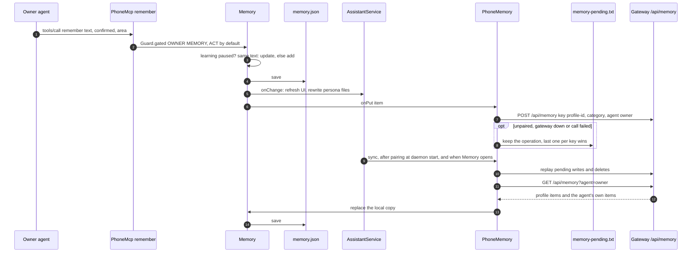

# Storage

All persistent state is in the app's private storage (`/data/data/org.rustlanglatam.zeroclaw.android/`),
readable only by the app's Linux user (and root), except the optional local model file, which is in
the app-specific external directory. Nothing is written to shared storage.

## The app's files

Every file in `files/` listed below is **sealed to this phone** (`Vault`,
[ADR-0023](../adr/0023-app-files-sealed-to-the-phone.md)): AES-256-GCM under a non-exportable key in
the Android Keystore (`ksandra-vault`, hardware-backed when available). Sealed text is `ks1:` +
Base64(IV ‖ ciphertext ‖ tag); line files are sealed line by line. Unprefixed text is legacy
plaintext, read as is and sealed on its next write. A copy on another device cannot be opened.

| Path | Written by | Contents |
|---|---|---|
| `files/policy.json` | `Guard.save` on one IO thread (write to `.tmp`, then rename) | rules, kill switch, undo seconds, daily-limit counters, messaging apps read, group chats on/off, owner's name, contacts → groups (family, work), voice and voice ceiling, floating mark, palette, form of address, warmth, language, email reading, open mic, offline opt-in, Home widgets, app mode |
| `files/activity.jsonl` | `Guard`, one line appended per entry, trimmed to the last entries | the activity log: time, principal, action, outcome, reason; actions still in the undo window when the app stopped are logged once as lost |
| `files/email_accounts` | `EmailAccounts` | connected IMAP/SMTP accounts: alias, provider, servers, address, app password, whether also seen on the phone |
| `files/mail.json` | `Mailbox` (`.tmp` + rename) | the last 100 emails read from notifications, which were opened, the next id, the last 1000 seen keys |
| `files/introduced.txt` | `Inbox` | conversations that already received the introduction |
| `files/digest.json` | `Inbox`, one writer thread | the last 200 incoming messages (id, time, sender, text, `Inbox.Status`, app, conversation) and the last one read; shown in Activity and the messages widget |
| `files/seen.txt` | `Inbox` | first line `since <ms>` (earlier messages are never handled), then one `<notification key> <time>` per handled message, last 2000; appended **before** the turn runs, so a crash loses a message rather than answering it twice |
| `files/memory.json` | `Memory` | the phone's copy of the owner's memory: id, text, told or inferred, time, area, date, ZeroClaw key, whether the agent stored it; `learning` and `migrated` flags |
| `files/memory-pending.txt` | `PhoneMemory` | memory writes and deletes not yet confirmed by ZeroClaw |
| `files/notes.json` | `Notes` | the copy of notes shown on Home (`show_on_home`), with optional expiry; the source of truth is ZeroClaw memory, category `widget` |
| `files/style.json` | `Empathy.Style` | the owner's learned style (length, tone) |
| `files/reminders.json` | `PhoneReminders` (`.tmp` + rename) | id, text, time, level, daily, unanswered calls |
| `files/topics.json` | `PhoneNews` (`.tmp` + rename) | followed topics, their time or interval, the last 60 headline links already reported |
| `files/briefings.json` | `PhoneNews` (`.tmp` + rename) | the last 30 briefings: text and headlines |
| `files/photo-index.json` | `PhoneGallery` | per photo id: on-device image labels and face count (computed on the phone with bundled models) |
| `cache/voice/` | `CloudVoice` | cloud voice audio for lines up to 160 characters, sealed, keyed by text, voice and style |

Other app state:

| Path | Written by | Contents |
|---|---|---|
| `shared_prefs/gateway.xml` | `AssistantService.prefs` | `EncryptedSharedPreferences` (keys AES-256-SIV, values AES-256-GCM, master key in the Keystore): the gateway **token**, the owner's chat **session id**, the offline agent's session id, the config version mark |
| `shared_prefs/absence.xml` | `CatchUp` | plain: last heartbeat, offline since, the last catch-up text and when |
| `cache/zeroclaw.log`, `cache/zeroclaw.previous.log` | the daemon's stdout and stderr | ZeroClaw's log for this run and the previous one |
| `cache/llama.log` | `llama-server` | the local engine's log |
| `cache/slots/` | `llama-server` | the saved prompt-cache slot (a few hundred MB), restored on the next engine start |
| `Android/data/<package>/files/models/` | `Offline` | the local model file (about 1 GB), downloaded on opt-in, verified by SHA-256, deleted on opt-out |

Held **only in memory** (lost when the process dies): pending approvals, the outbox (anything in its
undo window), notification reply actions and buttons, and the chat lines on screen (ZeroClaw keeps
the conversation itself).

Written **outside** the app, into the owner's own data: calendar events (`add_event`, `move_event`,
`delete_event`, in the primary writable calendar), alarms in the clock app (`create_alarm`,
`cancel_alarm`), contacts (`add_contact`, `edit_contact`, `delete_contact`), email drafts opened in
the owner's email app, messages written in WhatsApp for the owner to send, and system settings changed
by `device_setting`.

## ZeroClaw's files

The daemon runs with `--config-dir files/zeroclaw` and `HOME=files`.

| Path | Contents |
|---|---|
| `files/zeroclaw/config.toml` | written by the app (see below); ZeroClaw rewrites it when it saves state, notably the hashed paired tokens (`gateway.paired_tokens`) |
| `files/zeroclaw/agents/<agent>/workspace/` | the persona files the app writes (`IDENTITY.md`, `SOUL.md`, `USER.md`, `AGENTS.md`, `TOOLS.md`) for `owner`, `third_party`, `scribe` and `offline` |
| ZeroClaw's data directory under `files/zeroclaw/` | the memory database (SQLite, one database; entries scoped per agent), the gateway's session store (every `/ws/chat` session and its messages) and cron jobs |

`config.toml` holds: the model provider, model name and **API key** (two model profiles, `main` and
`warm`), the local model profile, the search provider and its key, the three MCP servers with their
per-process bearer keys, risk and runtime profiles per agent, `[memory] auto_save = false` and
`embedding_provider = "none"`, web search and fetch (fetch limited to news and reference domains),
`http_request` off, `[secrets] encrypt = false`, and one `[channels.email.<alias>]` per connected
account, with its **app password**, in observer mode.

**Why secrets encryption is off:** ZeroClaw publishes its secret key file with `link(2)`, which
SELinux denies to apps (upstream issue zeroclaw-labs/zeroclaw#11525,
[ADR-0004](../adr/0004-secrets-encryption-off.md)). The API key and email app passwords are therefore
plain text in `config.toml`, protected only by the app sandbox. The model key is also compiled into
the APK (`BuildConfig.MODEL_API_KEY`, from `local.properties`): anyone with the APK has it.

ZeroClaw's files are **not** sealed: ZeroClaw opens them itself, and v0.8.5 has no at-rest
encryption for them. They are protected by the sandbox and Android's file-based encryption only.

The session store keeps third-party conversations too: each third-party turn is a new session, and
it is not deleted. `auto_save = false` and `memory_recall_limit = 0` keep third parties out of
**memory**, not out of the session history.

## Memory: the phone and ZeroClaw

The owner's profile lives in the owner agent's memory in ZeroClaw
([ADR-0013](../adr/0013-memory-in-zeroclaw-with-phone-copy.md)). Each fact is stored under
`profile-<id>`, with category `profile:<area>:<told|inferred>`. What the agent stores itself with
ZeroClaw's `memory_store` appears in Memory as inferred, from a conversation. The phone keeps a
sealed copy (`memory.json`) to show it at once and offline.

Forgetting from the Memory screen or with `forget` removes the item locally and sends
`DELETE /api/memory/<key>?agent=owner`. Writes and deletes made while the daemon is unreachable are
kept in `memory-pending.txt` and replayed before the next sync.

## What leaves the phone

| What | Where | When |
|---|---|---|
| the persona files (including `USER.md`, the owner's profile), the conversation history ZeroClaw sends, tool results (contacts found, calendar, email content, file names, message texts) and third-party messages | the model provider | every agent turn, except `offline` turns |
| search queries and fetched pages | the configured web search provider; `web_fetch` only to news and reference sites | when the owner agent uses them |
| the topic's words, language and country | `news.google.com` | `news`, `follow_topic`, each check of a topic |
| latitude and longitude rounded to 0.1° (about 10 km) | `api.open-meteo.com` | weather widget and `weather`, at most every 30 min |
| the search query | YouTube Data API | `find_videos`, when a key is configured |
| the text to be spoken | the speech model provider | each line, when the natural voice is selected |
| IMAP reads, SMTP sends | the connected accounts' servers | continuously while an account is connected; sends only when approved |
| the reply text | the messaging app, which sends it | an approved or allowed reply, after the undo window |
| a message text | WhatsApp, written in the chat for the owner to send | `send_message` to a contact without a recent conversation |
| an email draft | the owner's email app, unsent | `draft_email`; the owner sends it |

Never leaves through the app: photos (labelled on the phone), the contacts list as such (no export
capability exists; `CONTACTS_EXPORT` is `FORBIDDEN`), the token, the policy file. The Settings
section "Permissions and privacy" states the same in the owner's language.

## Other copies

- **Android backup.** None: `android:allowBackup="false"` and `data_extraction_rules.xml` exclude
  every domain from cloud backups and device transfers (`config.toml` holds the model key, email app
  passwords and ZeroClaw's tokens).
- **Logcat.** Debug builds log chat lines, tool results, email senders and subjects and third-party
  turns at `INFO` (the end-to-end checks read them); release builds log only their length
  (`AssistantService.logged`).
